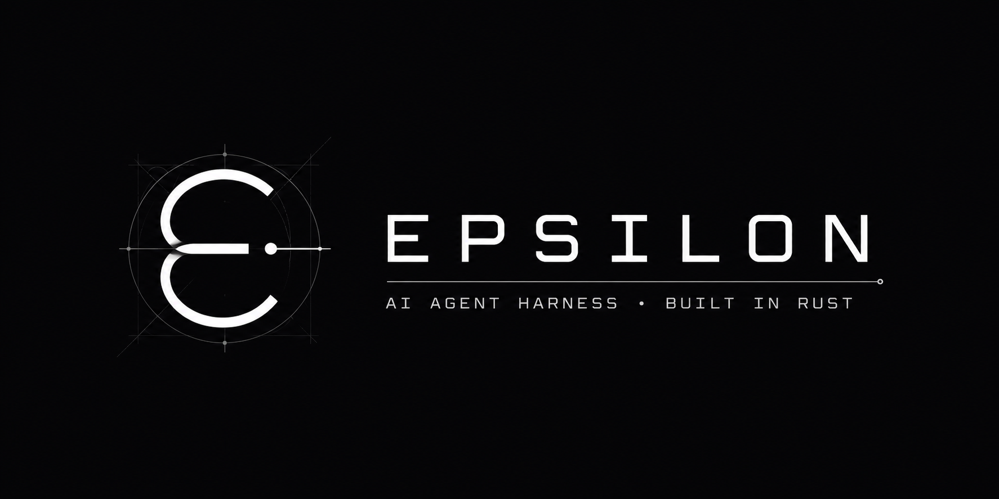

# Epsilon

<p align="center">
  
</p>

Epsilon is a coding-agent harness written in Rust: a terminal UI, a headless
mode, an HTTP/SSE server and a stdio RPC frontend over one agent core. It began
as a port of [pi-agent](https://github.com/earendil-works/pi) and has since taken
execution, permission and recovery ideas from DeepSeek Harness, Hermes Agent and
opencode.

The port is **not complete**, and this file says where it stops rather than
leaving that to be discovered.

## Contents

- [What it does](#what-it-does)
- [Install](#install)
- [Using it](#using-it)
- [Current status](#current-status)
- [How it is built](#how-it-is-built)
- [Working on it](#working-on-it)
- [Documentation](#documentation)
- [References and credits](#references-and-credits)

## What it does

You point it at a workspace and describe a task. It reads files, edits them, runs
commands, searches, delegates to subagents, and keeps a session you can resume.
Every side-effecting action passes a permission gate first, and on Windows the
commands it runs are confined by a Job Object, on Linux by bubblewrap where it is
installed.

It is a single binary with no required Node or Python runtime.

## Install

Rust 1.88 or newer.

```sh
cargo install --path crates/epsilon-cli --force
epsilon --help
```

From a clone, without installing:

```sh
cargo run -q -p epsilon-cli -- --demo     # offline, scripted, no provider needed
cargo run -q -p epsilon-cli               # the terminal UI
```

Platform notes, shell requirements and what each confinement backend does and
does not do are in [Install](docs/user/install.md) and
[Permissions](docs/user/permissions.md).

## Using it

| Command | What it does |
|---|---|
| `epsilon` | Interactive terminal UI |
| `epsilon -p "summarize this repo"` | One prompt, headless; approvals default to denial |
| `epsilon doctor` | Report configuration and available capabilities without running a model |
| `epsilon -c` / `epsilon --resume <file>` | Continue a session |
| `epsilon --serve --port 8787` | HTTP/SSE frontend |
| `epsilon --rpc` | NDJSON over stdio; accepts pi's `type` frames and replies with pi's envelope |
| `epsilon --plan` | Deny native write/edit/bash/shell, keeping project rules |

In the TUI, Enter sends, Esc cancels, `/help` lists commands, and the header shows
the model, the remaining context window, the cache hit rate and the running cost.

`/goal <objective>` parks one long-running objective in the session and keeps working on
it between turns; the footer shows its phase and rounds. See
[Goals](docs/user/goals.md).

For real providers, after configuring your own credentials:

```sh
epsilon auth login anthropic
epsilon --list-models
epsilon --model <model-id>
```

Credentials go through the local login prompt, never a command-line argument.
OAuth needs provider-specific setup: see [Auth](docs/user/auth.md).

## Current status

**An incomplete port, not production-ready.** The verification this rests on, and
what each number does and does not prove, is
[audit/11 — the 2026-09-16 assessment (history)](./audit/history/11-current-assessment.md). Read that before
trusting any claim here.

What is solid: the agent loop, the tool set, session storage, compaction, the
permission gate, and a test suite that runs offline against scripted providers —
including a terminal integration test that drives the real binary through a real
pseudo-console.

What is not: resolved filesystem containment for the native file tools is still
open; checkpoint restore has known gaps, so it is not yet a safe user-facing undo;
some pi features are unported; and nothing here has been certified on Linux or
macOS beyond CI compiling it.

Use backed-up or disposable workspaces until that list is shorter.

## How it is built

Twelve crates under `crates/`. Each has one job, and the edges between them are
documented rather than assumed — Cargo rejects cycles but will happily accept an
edge nobody meant to add.

| Crate | Responsibility |
|---|---|
| `epsilon-contracts` | Shared types and traits |
| `epsilon-llm` | Provider protocols, the offline provider, routing, catalog, auth, retry |
| `epsilon-session` | Session storage, indexing, branch projection, repair, leases |
| `epsilon-core` | Agent loop, scheduling, context assembly, compaction, task lifecycle |
| `epsilon-tools` | Native tools, the shell adapter, read observations, checkpoints |
| `epsilon-safety` | Permission rules and approvals, environment filtering, sandbox backends |
| `epsilon-lsp` | Optional language-server client and diagnostics |
| `epsilon-ext` | The process-extension protocol and its host |
| `epsilon-mcp` | MCP client and tool adapter |
| `epsilon-tui` | Terminal frontend |
| `epsilon-server` | HTTP/SSE frontend |
| `epsilon-cli` | The binary: arguments, configuration, runtime composition |

The [architecture guide](docs/design/epsilon-architecture.md) maps the real edges
and the execution paths. Decisions and their reasoning are recorded as ADRs in
[docs/design/epsilon-decisions.md](docs/design/epsilon-decisions.md).

## Working on it

Read [AGENTS.md](AGENTS.md) first — it is the contract for anyone editing this
repository, human or agent.

```sh
cargo fmt --all -- --check
cargo clippy --workspace --all-targets -- -D warnings
cargo test --workspace
cargo run -q -p epsilon-cli -- --demo
cargo check -p epsilon-cli --features real
```

`bash scripts/gate.sh <label>` (or `pwsh -File scripts/gate.ps1 <label>` on
Windows) runs all seven gates and writes `target/gate-<label>.log`.
Keep any evidence you want to cite outside `target/`, which is disposable.

Two habits that save time here:

- **Build with one job.** Long builds on a busy machine have failed with compiler
  startup errors under parallelism; `CARGO_BUILD_JOBS=1` and a target directory
  outside the repository have passed every round since.
- **The TUI has two test layers.** In-process golden frames check what a screen
  looks like; `crates/epsilon-cli/tests/terminal.rs` spawns the real binary in a
  pseudo-console and checks that it gets there at all. Run the second with
  `EPSILON_BIN=target/debug/epsilon cargo test -p epsilon-cli --test terminal` —
  the variable is optional, and it is the only test that can fail because
  the program never reached a terminal.

Test counts, gate results and their limits are recorded per milestone in
[docs/history.md](docs/history.md), not asserted here.

## Documentation

- [Documentation map](docs/README.md) — everything below, in one index.
- [User guides](docs/user/README.md) — install, configuration, auth, permissions, goals, sessions.
- [Audit and plan](audit/README.md) — what is verified, what is not, and what is next.
- [Architecture decisions](docs/design/epsilon-decisions.md) — recorded intent, including
  commitments not yet implemented.
- [Project history](docs/history.md) — the milestone timeline.

## References and credits

The reference harnesses studied while building this, none of them vendored:

| Reference | Areas studied |
|---|---|
| [pi 0.85.1](https://github.com/earendil-works/pi) | Agent loop, queues, coding tools, sessions, resources, prompt assembly |
| [DeepSeek Harness v0.1.6-alpha.2](https://github.com/deepseek-ai/deepseek-harness) | Bounded capture, subprocess lifecycle, design tokens |
| [Hermes Agent 2026.9.14](https://github.com/NousResearch/hermes-agent) | Observer identity, verification evidence, prompts, recovery |
| [opencode 1.18.31](https://github.com/anomalyco/opencode) | Permissions, change provenance, language-server edit feedback |

[Reference comparison](./audit/06-references.md) explains which mechanisms
fit and which do not. [models.dev](https://models.dev) supplies catalog research
via `scripts/regen_catalog.py`. These acknowledgements credit the ideas; they are
not a claim of complete fidelity, nor a substitute for a licence review before
any of this is redistributed.
