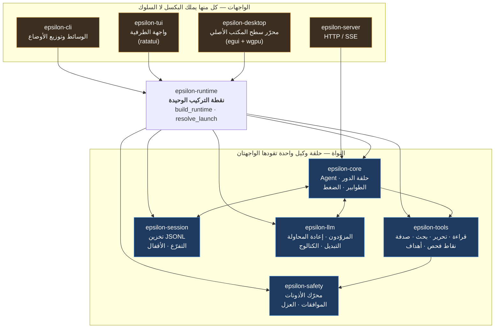

# ابدأ من هنا

دليل قراءة لأي شخص يلتقي بمشروع **Epsilon** لأول مرة: مراجع، أو مساهم، أو من يريد فقط أن يعرف
ما هذا المشروع.

لا تحتاج إلى معرفة لغة Rust. تحتاج إلى معرفة ما هو **وكيل** (agent)، فها هو قبل أي شيء آخر:
**الوكيل برنامج ينفّذ هدفًا تصفه له، فيقرّر ما الذي يفعله تاليًا ثم يفعله** — يقرأ ملفًا، أو
يشغّل أمرًا، ثم ينظر إلى النتيجة قبل أن يختار من جديد. ليس روبوت محادثة يردّ بالنصّ وحده، وليس
نصًّا برمجيًّا يتّبع خطوات كتبتها مسبقًا. التعريف الكامل في
[مسرد المصطلحات](#٥-مسرد-المصطلحات) إن أردته لاحقًا؛ وكل ما يلي يفترض هذا القدر.

> هذه نسخة عربية من [`START-HERE.md`](START-HERE.md)، وهي مطابقة له في البنية والمحتوى.
> إن لاحظت اختلافاً بينهما، فالأصل الإنجليزي هو المرجع.

---

## ١. جولة في عشر دقائق

**Epsilon وكيل برمجي بالذكاء الاصطناعي.** تعطيه مجلداً فيه شيفرة، وتصف له مهمة بكلمات عادية.
فيقرأ الملفات، ويحرّرها، وينفّذ الأوامر، ويحفظ سجل المحادثة حتى تتمكن من العودة إليها لاحقاً.
كل إجراء يغيّر شيئاً ما يطلب الإذن أولاً.

**له واجهتان أمام واحدة، على محرّك واحد.**

- **واجهة الطرفية** (`epsilon`) — تطبيق كامل الشاشة يمكن قيادته بالكامل من لوحة المفاتيح.
- **واجهة سطح المكتب** (`epsilon-desktop`) — نافذة حقيقية في نظام التشغيل، فيها شجرة ملفات،
  ومحرّر، والمحادثة إلى جانبها.

ليستا برنامجين. هما طريقتان لعرض المحادثة نفسها، وكلاهما يتحدث إلى الوكيل نفسه. إن وافقتَ
على أمر في الطرفية ونفّذتَ الأمر نفسه في النافذة، فالقواعد نفسها هي التي تقرّر. هذه هي الفكرة
المركزية في التصميم، ومن المفيد أن تتحقق منها بنفسك: نفّذ المهمة نفسها في الاثنين وقارن.

**يعمل في أي مكان توجد فيه أدوات Rust.** ملف تنفيذي واحد. بلا Node، وبلا Python، وبلا خدمة
مرافقة. يكفي `cargo install` ليعمل.

**يمكنك قراءته في جلسة واحدة.** الشيفرة المثيرة للاهتمام موزّعة على أربعة عشر مجلداً صغيراً
تحت `crates/`، لكل منها مهمة واحدة. الخريطة في [القسم ٣](#٣).

### جرّبه في دقيقتين تقريباً

```sh
cargo run -q -p epsilon-cli -- --demo
```

يشغّل محادثة مكتوبة مسبقاً دون اتصال — بلا مفتاح API، وبلا شبكة، وبلا تكلفة. يوضّح شكل
الدورة: يردّ المساعد، ثم يستدعي أداة، فيصلته النتيجة، فيردّ مرة أخرى.

للاستخدام الحقيقي تحتاج إلى بيانات اعتماد لمزوّد نماذج؛ انظر
[`../README.md`](../README.md) و[`user/install.md`](user/install.md).

---

## ٢. إن قرأت ثلاثة ملفات فقط، فاقرأ هذه

1. **[`../README.md`](../README.md)** — ما هو المنتج وكيف يُشغَّل.
2. **[`design/epsilon-decisions.md`](design/epsilon-decisions.md)** — القرارات المرقّمة (ADR)
   مع أسبابها. تصفّح العناوين؛ الأسباب هي الجزء المثير.
3. **[`../AGENTS.md`](../AGENTS.md)** — القواعد التي يجب على أي من يغيّر هذه الشيفرة اتباعها:
   الثوابت، والأوامر، ومعيار الإثبات. هذا الملف **مقفل** ولا يحوي إلّا ما يبقى صحيحًا؛ أمّا ما
   هو صحيح **اليوم** فاقرأ [`STATUS.md`](STATUS.md).

---

## ٣. ترتيب قراءة مقترح

إن لديك ساعة، بهذا الترتيب.

| # | اقرأ | ما تحصل عليه |
|---|---|---|
| ١ | [`../README.md`](../README.md) | المنتج، بلغة واضحة |
| ٢ | [`STATUS.md`](STATUS.md) | **ما هو صحيح الآن** — ما يعمل، وما أُلغي، وما المعطوب |
| ٣ | [`../AGENTS.md`](../AGENTS.md) | القواعد، والثوابت المعمارية، والأوامر |
| ٤ | [`design/epsilon-architecture.md`](design/epsilon-architecture.md) | كيف تتصل القطع ببعضها. اقرأ صندوق التحذير فيه: الملف جزئياً قديم، وهو يقول ذلك بنفسه |
| ٥ | [`design/epsilon-decisions.md`](design/epsilon-decisions.md) | لماذا بُني كما بُني، قراراً بقرار |
| ٦ | [`references/README.md`](references/README.md) | من أين جاءت الأفكار، و[`CREDITS.md`](../CREDITS.md) للشكر الرسمي |
| ٧ | [`START-HERE.md`](START-HERE.md) (هذا الملف) | الخريطة والمصطلحات |
| ٨ | الشيفرة، بدءاً من `crates/epsilon-core/src/lib.rs` | حلقة الوكيل نفسها |

### خريطة المجلدات: ماذا يفعل كل مجلد، وهل يهمّك

| المجلد | ماذا يفعل | من يهمّه |
|---|---|---|
| `crates/epsilon-contracts` | الأنواع التي تتفق عليها بقية الصناديق. بلا سلوك. | من يغيّر شكل رسالة ما |
| `crates/epsilon-core` | **الوكيل.** الحلقة التي تستدعي نموذجاً، وتنفّذ الأدوات، وتقرّر ما يحدث تالياً | الجميع تقريباً. ابدأ من هنا |
| `crates/epsilon-runtime` | **المكان الوحيد** الذي يتحوّل فيه إعدادٌ ما إلى وكيل يعمل. كلتا الواجهتين تستدعيه | من يضيف خطوة إقلاع أو إعداداً أو واجهة |
| `crates/epsilon-tools` | الأدوات التي يستطيع الوكيل استخدامها: قراءة، تحرير، بحث، صدفة، مهام، أهداف | من يضيف قدرة أو يغيّر واحدة |
| `crates/epsilon-safety` | قواعد الأذونات، ونافذة الموافقة، والعزل | من يلمس ما يُسمح للوكيل به |
| `crates/epsilon-session` | حفظ المحادثات وترتيبها والتفرّع عنها ومتابعتها | من يغيّر سلوك الجلسات |
| `crates/epsilon-llm` | التحدث إلى مزوّدي النماذج؛ إعادة المحاولة، والتبديل، وكتالوج النماذج | من يضيف مزوّداً أو يغيّر معالجة النماذج |
| `crates/epsilon-tui` | واجهة الطرفية | مستخدمو الطرفية والمساهمون |
| `crates/epsilon-desktop` | واجهة سطح المكتب | مستخدمو سطح المكتب والمساهمون |
| `crates/epsilon-cli` | الملف التنفيذي: تحليل الوسائط، واختيار الوضع | من يضيف خياراً سطرياً |
| `crates/epsilon-server` | واجهة HTTP/SSE للبرامج الأخرى | من يدمج المشروع |
| `crates/epsilon-lsp` | تكامل اختياري مع خوادم اللغات (الإكمال، الأخطاء) | من يعمل على تجربة المحرّر |
| `crates/epsilon-mcp` | الاتصال بخوادم أدوات خارجية (MCP) | من يوسّع مجموعة الأدوات |
| `crates/epsilon-ext` | تشغيل عمليات مساعدة من طرف ثالث | من يعمل على الامتدادات |
| `docs/` | كل ما كُتب: القرارات، والتاريخ، والأدلة، وهذا الملف | المراجعون والمساهمون |
| `audit/` | تقييم أقدم لحالة المشروع. **مُستبدَل** بـ `docs/STATUS.md` عند التعارض | من يبحث في التاريخ |
| `references/` | المشاريع الستة التي دُرست، نسخة للقراءة فقط. لا تُبنى ولا تُودَع في git | الفضوليّ |
| `scripts/` | حزمة التحقق وفحوص المستودع | المساهمون |
| `agents/memory/` | ملاحظات عملتركها جلسات سابقة | من يسلّم عملاً سابقاً |

---

## ٤. كيف تتصل القطع ببعضها

نواة واحدة، وواجهتان أماميتان، ونقطة تركيب واحدة.



اقرأه هكذا: **الأسهم نحو النواة هي الطريق الوحيد للدخول.** تطلب الواجهتان من
`epsilon-runtime` أن يبني وكيلاً، ولا تبني أيٌّ منهما وكيلاً بنفسها. ولهذا السبب لا يمكن
لهما أن ينحرفا عن بعضهما: لا يوجد ما ينحرف، لأن هناك نسخة واحدة فقط.

**وسهمٌ واحد في هذا الرسم مختلف، والرسم على حقٍّ في رسمه.** ‏`epsilon-server` مرسوم خارج
`epsilon-runtime` لأنه كذلك فعلًا: ‏`serve_mode()` تركّب الوكيل عبر `build_runtime` ثم **تسلّم
الخادم وكيلًا جاهزًا**، فلا يكون للخادم أي ارتباط بـ `epsilon-runtime` خاص به. ومع ذلك فهو ما
زال فوق النواة نفسها: يتلقّاها بدل أن يطلبها. أما الواجهتان المقصودتان في الجملة أعلاه
فهما اللتان يقودهما الإنسان.

---

## ٥. مسرد المصطلحات

المصطلحات المستعملة في هذا الدليل وفي توثيق المشروع.

**crate (حزمة)** — مجلد واحد تحت `crates/` يحوي مكتبة Rust واحدة ذات مهمة واحدة. الخريطة في
§3 قائمة把这些 المجلدات. يتحقّق Cargo (أداة بناء Rust) من اتجاه الاعتماديات بينها، فلا تستطيع
حزمة أن تستعمل ما لا يحقّ لها استعماله من صامت.

**JSONL** — اختصار "JSON Lines": ملف نصّي (سجل واحد لكل سطر بصيغة JSON). تُخزَّن الجلسة
بهذه الصيغة، فيبقى الحوار مقروءًا في أي محرّر نصوص، وتلف سطر يكلّف سطرًا لا الملف كلّه.

**Milestone (`M###`)** — وحدة عمل مرقّمة في تاريخ المشروع. `M276` هي العمل رقم مئتين وستّة
وسبعين. **الترقيم يتجاوز حيث تتوقف السجلات، ومعرفة الفجوة تفيدك قبل أن تبحث:** في
[`history.md`](history.md) صفٌّ لكل إنجاز حتى **M276**، وآخر سجلّ تطوير في `milestones/` هو
**M276** أيضًا — أمّا `M277` وما بعده فلا سجلّ لها ولا صفّ في التاريخ، وذلك قرار مُسجَّل لا
سهو. العمل بعد ذلك موجود في [`STATUS.md`](STATUS.md) وفي
[`../CHANGELOG.md`](../CHANGELOG.md).

**Ponytail** — انضباط في الإقلال يطبّقه المشروع قبل إضافة أي شيء، من تأليف
[DietrichGebert](https://github.com/DietrichGebert/ponytail) (رخصة MIT). يطرح سؤالًا واحدًا
بالترتيب: هل هذا يحتاج أن يوجد أصلًا؟ أهو موجود هنا؟ هل تقوم المكتبة القياسية بذلك؟ هل تقوم
منصّة النظام بذلك؟ هل تكفي تبعية مثبّتة؟ ثم اكتب أصغر نسخة ممكنة. هو **مراجِع** لا عائق، ولا
يوقف أبدًا ميزةً مبرَّرةً ولا إصلاحًا أمنيًّا. انظر [`CREDITS.md`](../CREDITS.md).

**وكيل (agent)** — برنامج ينفّذ أهدافاً تصفها له. ليس محادثة لها جسد: إنه يقرأ الملفات،
وينفّذ الأوامر، ويغيّر أشياء، تحت إشراف.

**حلقة الوكيل (agent loop)** — الدورة المتكرّرة في قلب النظام: تُرسَل المحادثة إلى نموذج،
ويُنفَّذ ما طلب من أدوات، وتُعاد النتائج، ويتكرّر ذلك حتى تنتهي.

**مزوّد (provider)** — شركة أو خادم يستضيف نماذج (Anthropic، أو DeepSeek، أو خادم محلي).
يهيّئ المستخدم بيانات اعتماد لواحد على الأقل.

**نموذج (model)** — النموذج بعينه الذي يقدّمه المزوّد. يستطيع المستخدم تبديل النماذج أثناء
المحادثة.

**أداة (tool)** — قدرة يستطيع الوكيل استدعاؤها: قراءة ملف، تحريره، تنفيذ أمر صدفة، بحث.
لكل أداة اسم ومجموعة وسائط ونتيجة.

**دور (turn)** — مرور كامل واحد في الحلقة: ردّ النموذج واحد مع الأدوات التي طلبها.

**التوجيه / المتابعة (steering / follow-up)** — رسائل تضيفها *أثناء* عمل الوكيل.
*التوجيه* يغيّر ما يفعله الآن؛ و*المتابعة* تُحجز لتُنفَّذ بعد أن ينتهي.

**الضغط (compaction)** — حين تكبر المحادثة عن نافذة السياق الخاصة بالنموذج، تُلخَّص،
ويُستبدل التاريخ التفصيلي بالملخّص مع أحدث التبادلات. المحادثة تستمر، والسجل يحتفظ بالأصل.

**نافذة السياق (context window)** — كم نصاً يستطيع النموذج أن يدرسه في وقت واحد. يُقاس
بالـ tokens. يعرض الشريط العلوى مقدار امتلائها.

**Token** — نحو ثلاثة أرباع الكلمة الإنجليزية. النماذج تقرأ وتكتب رموزاً لا حروفاً.

**بوابة الأذونات (permission gate)** — الفحص الذي يمرّ به كل إجراء ذي أثر قبل أن يحدث. قاعدة
تقرّر تلقائياً، أو يطلب الوكيل إذنك.

**موافقة (approval)** — اللحظة التي تطلب فيها بوابة الأذونات رأي شخص. تعرضها الواجهتان
بالطريقة نفسها.

**عزل / تقييد (sandbox / confinement)** — قيود على ما يمكن لأمر مُشغَّل أن يفعله. على ويندوز
يتم ذلك عبر Job Object، وعلى لينكس عبر bubblewrap إن كان مثبتاً.

**جلسة (session)** — محادثة محفوظة على القرص كملف JSONL. يمكنك سردها واستئنافها والتفرّع عنها
وتنشئ نسخة منها وتصديرها.

**تفرّع / اشتقاق (branch / fork)** — المتابعة من نقطة سابقة في المحادثة. *التفرّع* هو خط
التاريخ، و*الاشتقاق* ينسخ الجلسة إلى ملف جديد.

**استئناف (resume)** — فتح جلسة محفوظة والمتابعة فيها.

**هدف (goal)** — هدف طويل الأمد يُحفظ في الجلسة. `/goal <ما يجب تحقيقه>` يحدّده، ويعمل
الوكيل عليه عبر أدوار متتالية، وتعرض التذييلات مرحلته.

**مهمة / وكيل فرعي (task / sub-agent)** — عمل يوكّله الوكيل إلى وكيل متداخل، كي لا تمتلئ
المحادثة الرئيسية بعمل كبير. العمق مقصور عمداً على مستوى واحد.

**MCP** (بروتوكول سياق النموذج) — طريقة قياسية تُتيح لبرنامج تقديم أدوات إلى تطبيق ذكاء
اصطناعي، فتُوصل خوادم أدوات طرف ثالث دون تغيير الوكيل.

**امتداد (extension)** — عملية من طرف ثالث يُشغّلها Epsilon ويتحدث إليها عبر بروتوكول رسائل
صغير.

**مهارة (skill)** — حزمة تعليمات مسمّاة يحمّلها الوكيل لنوع من المهام. تُكتشَف من مساحة العمل
ومجلد المستخدم، وتُؤطَّر بالثقة.

**LSP** (بروتوكول خادم اللغة) — المعيار الذي تستخدمه المحرّرات للحصول على الإكمال وتشخيصات
الأخطاء من أدوات اللغة نفسها.

**مزوّد وهمي (faux provider)** — بديل مكتوب السكربت عن نموذج حقيقي، يستخدمه طقم الاختبار كي
تجري آلاف الاختبارات دون اتصال، وبشكل حتمي، دون تكلفة.

**ADR** (سجل قرار معماري) — مُدخَل مرقّم في
[`design/epsilon-decisions.md`](design/epsilon-decisions.md) يسجّل قراراً وأسبابه، بما في
ذلك الخيارات التي رُفضت.

**الحزمة (battery)** — الأمر الواحد الذي يشغّل كل الفحوص: التنسيق، والتحليل، والاختبارات،
وفحوص الروابط والبايتات على مستوى المستودع، وعرض توضيحي دون اتصال. انظر
[`../AGENTS.md`](../AGENTS.md).

**واجهة أمامية (front end)** — طريقة لعرض الشيء نفسه. هنا: تطبيق الطرفية، ونافذة سطح المكتب.

---

## ٦. إن كنت تراجع هذا العمل

ثلاثة أسئلة تجيب عن معظمه.

1. **هل هذا نظام واحد، أم برنامجان يتفقان؟** نفّذ المهمة نفسها في الطرفية وفي النافذة،
   وقارن.
2. **هل سطح المكتب تطبيق حقيقي، أم صفحة ويب داخل إطار؟** هو أصلي: egui فوق winit وwgpu، بلا
   متصفّح مدمج. انظر ADR-020.
3. **هل تطابق الادّعاءات الشيفرة؟** [`STATUS.md`](STATUS.md) يقول ما جرى التحقق منه وكيف.
   و[`../AGENTS.md`](../AGENTS.md) يشرح قواعد الأدلة التي يفرضها المشروع على نفسه، بما فيها
   القواعد التي تعلّمها بالخطأ.

## ٧. إن أردت تغيير شيء

اقرأ [`../AGENTS.md`](../AGENTS.md) أولاً — قصير، وهو العقد. ثم شغّل الفحوص التي يسمّيها قبل
أي تغيير، لتعرف ما كان صحيحاً أصلاً.

```sh
pwsh -File scripts/gate.ps1 mycheck    # ويندوز
bash scripts/gate.sh mycheck           # ماك ولينكس
```
