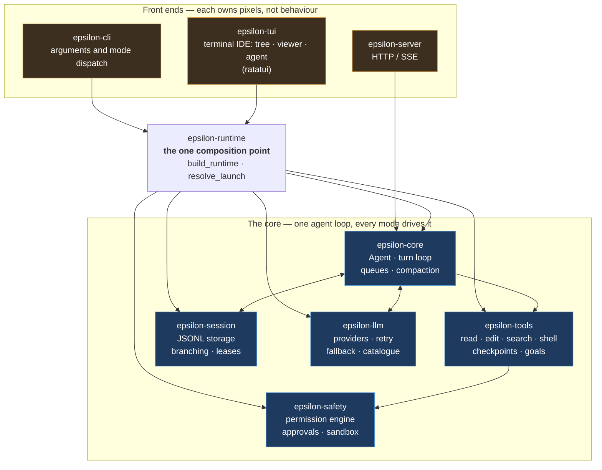

# Start here

A reading guide for anyone meeting Epsilon for the first time — reviewer, contributor, or
someone who just wants to know what this thing is.

You do not need to know Rust. You do need to know what an **agent** is, so here it is before
anything else: **an agent is a program that carries out a goal you describe, by deciding what to
do next and doing it** — reading a file, running a command, then looking at the result before
choosing again. It is not a chatbot that only replies in text, and it is not a script that
follows steps you wrote in advance. The full entry is in
[the glossary](#5-glossary) if you want it later; everything below assumes this much.

---

## 1. A ten-minute tour

**Epsilon is an AI coding agent.** You point it at a folder of code and describe a task in
plain language. It reads files, edits them, runs commands, and keeps a record of the
conversation so you can come back to it later. Every action that changes something asks
permission first.

**It has one full-screen terminal IDE over one engine.**

- **The terminal IDE** (`epsilon`) — the full-screen app you drive entirely from the
  keyboard: a file tree (F6), a read-only file viewer (Enter), and the agent
  conversation beside them, plus command palette, themes, and headless/HTTP/RPC modes.

**It runs anywhere a Rust toolchain does.** One binary. No Node, no Python, no companion
service. Install it from source with `cargo install --path crates/epsilon-cli` — it is **not
published to crates.io**, so the `--path` form is the one that works.

**You can read it in one sitting.** The interesting code is in thirteen small folders
under `crates/`, each with one job. The map is in §3.

### Try it, in about two minutes

```sh
cargo run -q -p epsilon-cli -- --demo
```

That runs a scripted conversation offline — no API key, no network, no cost. It shows the
shape of a turn: the assistant replies, calls a tool, gets a result, replies again.

For the real thing you need credentials for a model provider; see
[`../README.md`](../README.md) and [`user/install.md`](user/install.md).

---

## 2. If you read only three files, read these

1. **[`../README.md`](../README.md)** — what the product is and how to run it.
2. **[`design/epsilon-decisions.md`](design/epsilon-decisions.md)** — the numbered decisions
   (ADRs) with their reasoning. Skim the headings; the reasons are the interesting part.
3. **[`../AGENTS.md`](../AGENTS.md)** — the rules anyone changing this code must follow: the
   invariants, the commands, the evidence standard. It is locked and deliberately holds only
   what stays true; for what is true **today**, read [`STATUS.md`](STATUS.md).

---

## 3. A suggested reading order

If you have an hour, in this order.

| # | Read | What you get |
|---|---|---|
| 1 | [`../README.md`](../README.md) | The product, in plain terms |
| 2 | [`STATUS.md`](STATUS.md) | **What is true right now** — what works, what is cut, what is broken |
| 3 | [`../AGENTS.md`](../AGENTS.md) | The rules, the invariants, the commands |
| 4 | [`../AGENTS.md`](../AGENTS.md) §3, the repository map | Where each crate is and what it is for, **kept true** — this is the current map |
| 4b | [`design/epsilon-architecture.md`](design/epsilon-architecture.md) | The dependency graph in more detail, and the history of why the layout is what it is. **Read its warning box first:** it is a dated snapshot from the audit era and says so, so treat a specific claim in it as a hypothesis to check rather than as current description |
| 5 | [`design/epsilon-decisions.md`](design/epsilon-decisions.md) | Why it is built this way, decision by decision |
| 6 | [`references/README.md`](references/README.md) | Where the ideas came from, and [`CREDITS.md`](../CREDITS.md) for the formal credit |
| 7 | [`START-HERE.md`](START-HERE.md) (this file) | The map and the vocabulary |
| 8 | The code, starting at `crates/epsilon-core/src/lib.rs` | The agent loop itself |

### Map: what each folder is, and whether you care

| Folder | What it does | Who cares about it |
|---|---|---|
| `crates/epsilon-contracts` | The types every other crate agrees on, and the command registry every mode reads. No behaviour beyond parsing. | Anyone changing the shape of a message, or what a `/word` means |
| `crates/epsilon-core` | **The agent.** The loop that calls a model, runs tools, and decides what happens next | Almost everyone. Start here |
| `crates/epsilon-runtime` | **The one place** a configuration becomes a running agent. Every mode calls it | Anyone adding a startup step, a setting, or a front end |
| `crates/epsilon-tools` | The tools the agent can use: read, edit, search, shell, tasks, goals | Anyone adding or changing a capability |
| `crates/epsilon-safety` | Permission rules, the approval prompt, and the sandbox | Anyone touching what the agent is allowed to do |
| `crates/epsilon-session` | Saving, listing, branching and resuming conversations | Anyone changing session behaviour |
| `crates/epsilon-llm` | Talking to model providers; retry, fallback, the model catalogue | Anyone adding a provider or changing model handling |
| `crates/epsilon-tui` | The terminal IDE: tree, viewer, transcript, composer, palette | Terminal users and contributors |
| `crates/epsilon-cli` | The binary: argument parsing, and choosing a mode | Anyone adding a command-line flag |
| `crates/epsilon-server` | An HTTP/SSE front end for other programs | Anyone integrating |
| `crates/epsilon-lsp` | Optional integration with language servers (completion, errors) | Editor-experience work |
| `crates/epsilon-mcp` | Connecting to external tool servers (MCP) | Anyone extending the tool set |
| `crates/epsilon-ext` | Running third-party helper processes | Extension work |
| `docs/` | Everything written down: decisions, history, guides, this file | Reviewers, contributors |
| `docs/parity/` | **One row per behaviour** against the project this is a port of — [a guide to reading them](parity/README.md) first. The DSH desktop matrix is retired (ADR-039) | Anyone asking "how close is it?" |
| `audit/` | Older assessment of the project's state. **Superseded** by `docs/STATUS.md` where they disagree | Historians |
| `references/` | The six projects studied, vendored read-only. Not built, not committed | The curious |
| `scripts/` | The verification battery and repository checks | Contributors |
| `agents/memory/` | Working notes left by previous sessions | Contributors picking up old work |

---

## 4. How the pieces connect

One core, one terminal IDE, one composition point.



Read it as: **the arrows into the core are the only way in.** Every mode asks
`epsilon-runtime` to build an agent; none builds one itself. That is why they cannot drift
apart — there is nothing to drift, because there is only one copy.

(The desktop IDE `epsilon-desktop` was removed in ADR-039; the diagram above no longer
draws it. The retired DSH parity matrix is frozen history under `docs/parity/`.)

**One arrow in that diagram is different, and the diagram is right to draw it.**
`epsilon-server` is drawn outside the runtime because it genuinely is: `serve_mode()` composes
the agent through `build_runtime` and **hands the server a finished one**, so the server has no
`epsilon-runtime` edge of its own. It is still one core behind it — it just receives the core
rather than asking for it. The modes a person drives are the terminal IDE and the
headless/HTTP/RPC modes above.

---

## 5. Glossary

Terms used in this guide and in the project's own documentation.

**Crate** — one folder under `crates/` holding one Rust library, with one job. The map in §3 is
a list of crates. Cargo (Rust's build tool) checks that they only depend on each other in the
allowed direction, so a crate cannot quietly use one it should not.

**JSONL** — "JSON Lines": a text file with one JSON record per line. A session is stored as one,
so a conversation stays readable in any text editor and a damaged line costs one line rather
than the file.

**Milestone (`M###`)** — a numbered unit of work in this project's history. `M276` is the
two-hundred-and-seventy-sixth. **The numbering runs past where the records do, and the gap is
worth knowing about before you go looking:** `history.md` has a row for every milestone up to
**M276**, and the last dev log under `milestones/` is `M276` too — `M277` onward have no log and
no history row, by a recorded decision rather than by omission. Work after that lives in
[`STATUS.md`](STATUS.md) and in [`../CHANGELOG.md`](../CHANGELOG.md).

**Ponytail** — a minimalism discipline this project applies before adding anything, by
[DietrichGebert](https://github.com/DietrichGebert/ponytail) (MIT). It asks one question in
order: does this need to exist; is it already here; does the standard library do it; does the
platform do it; is an installed dependency enough. Then write the smallest version. It is a
reviewer, not a blocker — it never stops a justified feature or a safety fix. See
[`CREDITS.md`](../CREDITS.md).

**Agent** — a program that carries out goals you describe. It is not a chatbot with a body: it
reads files, runs commands, and changes things, under supervision.

**Agent loop** — the repeating cycle at the heart of the system: send the conversation to a
model, run whatever tools it asked for, feed the results back, repeat until it is done.

**Provider** — a company or server that hosts models (Anthropic, DeepSeek, a local server).
The user configures credentials for at least one.

**Model** — the specific model a provider serves. The user can switch models mid-conversation.

**Tool** — a capability the agent can invoke: reading a file, editing one, running a shell
command, searching. Each one has a name, a set of arguments, and a result.

**Turn** — one complete pass of the loop: one model reply plus any tools it requested.

**Steering / follow-up** — messages you add *while* the agent is working. *Steering* changes
what it is doing now; a *follow-up* queues for after it finishes.

**Compaction** — when a conversation grows past the model's context window, it is summarised
and the detailed history is replaced by the summary plus the most recent exchanges. The
conversation continues; the transcript keeps the original.

**Context window** — how much text a model can consider at once. Measured in tokens. The
header shows how full it is.

**Token** — roughly three quarters of an English word. Models read and write tokens, not
characters.

**Permission gate** — the check every side-effecting action passes before it happens. A rule
decides automatically, or the agent asks you.

**Approval** — the moment a permission gate asks a person. Every mode shows it the same way.

**Sandbox / confinement** — restrictions on what a spawned command may do. On Windows this is
a Job Object; on Linux, bubblewrap where installed.

**Session** — a saved conversation, on disk as a JSONL file. You can list, resume, branch, fork
and export them.

**Branch / fork** — continuing from an earlier point in a conversation. A *branch* is the line
of history; a *fork* copies the session to a new file.

**Resume** — opening a saved session and carrying on in it.

**Goal** — one long-running objective parked in a session. `/goal <what to achieve>` sets it;
the agent keeps working across turns, and the footers show its phase.

**Task / sub-agent** — a job the agent delegates to a nested agent, to keep a large job from
filling the main conversation. Depth is deliberately limited to one level.

**MCP** (Model Context Protocol) — a standard way for a program to expose tools to an AI
application, so third-party tool servers can be connected without changing the agent.

**Extension** — a third-party process Epsilon launches and talks to over a small message
protocol.

**Skill** — a named instruction bundle the agent loads for a kind of task. Discovered from the
workspace and the user's home directory, and trust-gated.

**LSP** (Language Server Protocol) — the standard editors use to get completion and error
diagnostics from a language's own tooling.

**Faux provider** — a scripted stand-in for a real model, used by the test suite so that
thousands of tests run offline, deterministically and at no cost.

**ADR** (Architecture Decision Record) — a numbered entry in
[`design/epsilon-decisions.md`](design/epsilon-decisions.md) recording a decision and its
reasoning, including the options that were rejected.

**Battery** — the one command that runs every check: formatting, linting, tests, link and
byte-level repository checks, and an offline demo. See [`../AGENTS.md`](../AGENTS.md).

**Front end / frontend** — a way of drawing the same underlying thing. Here: the terminal IDE
and the headless/HTTP/RPC modes.

---

## 6. If you are reviewing this work

Three questions answer most of it.

1. **Is it really one system, or several programs that agree?** Run the same task in the
   terminal IDE and headless (`-p`). Compare.
2. **Do the claims match the code?** [`STATUS.md`](STATUS.md) says what is verified and how.
   [`../AGENTS.md`](../AGENTS.md) explains the evidence rules that project holds itself to,
   including the ones it learned by getting them wrong.

### The two parity matrices, and how to read one

The terminal IDE is a **port**: [Pi](https://github.com/earendil-works/pi)'s
interactive terminal mode. A port means *the same
thing happens, the same way* — not the same pixels. (The desktop window port of **DSH Desktop**
was retired with the desktop in ADR-039; its matrix is frozen history.)

[`docs/parity/`](parity/README.md) holds one row per behaviour:

| File | Compares our… | Against |
|---|---|---|
| [`pi-tui.md`](parity/pi-tui.md) | terminal IDE | Pi's interactive terminal mode |
| [`dsh-desktop.md`](parity/dsh-desktop.md) | RETIRED (ADR-039) | DSH Desktop |

Read the [guide in that folder](parity/README.md) first — it explains the four statuses
(`done`, `partial`, `missing`, `deliberately different`) and why a row is allowed to say no.

The one thing to know before you judge a row: **`done` means exercised, not written.** A row is
`done` only when something was run or rendered and looked at. And a row that says
`deliberately different` has to name a reason that would make the product *worse* if we copied the
reference — a licence, a platform limit, or the accessibility
standard in [`../AGENTS.md`](../AGENTS.md) §8. "We did not get to it" is written as **missing**,
never dressed up as a decision.

The evidence each row was built from is under [`../audit/evidence/`](../audit/evidence/) — **869
cited rows** read from the vendored sources, every one pointing at a line.

## 7. If you want to change something

Read [`../AGENTS.md`](../AGENTS.md) first — it is short, and it is the contract. Then run the
checks it names before you change anything, so you know what was already true.

```sh
pwsh -File scripts/gate.ps1 mycheck    # Windows
bash scripts/gate.sh mycheck           # macOS, Linux
```
