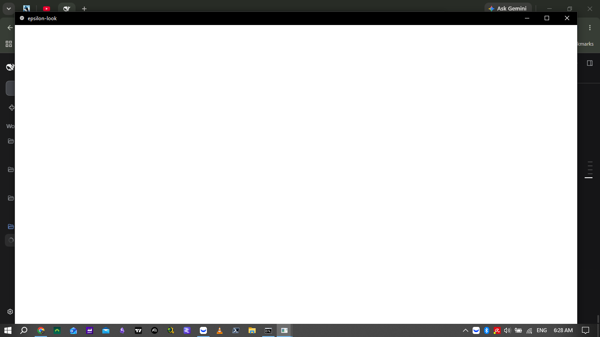
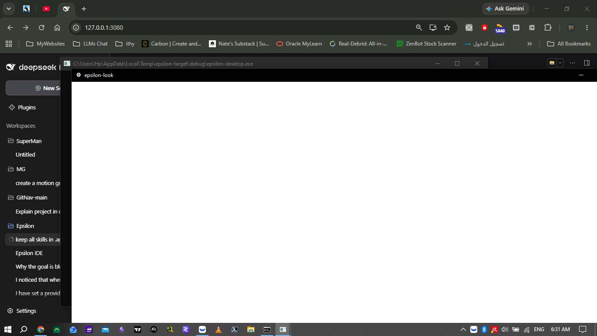

# M252 — the window was opened, and looked at

Five milestones of desktop work had carried the same sentence — *"every claim is an
offscreen measurement; nothing has been rendered through wgpu."* That sentence was a debt
accruing on every feature, and by M251 it was larger than any single thing being built.

So this milestone did the thing the notes kept saying to do: **it ran the binary and
looked.**

## What it found

The window opens — correct title, correct size, real title bar — and the content area is
**blank white**. Not the wrong colours: nothing at all.



`App::ui` *is* running. A probe printed `content_rect=[[0.0 0.0] - [1280.0 768.0]]` on every
frame for the life of the process. The draw path runs, at the right size, sixty times a
second.

The probe that localised it: fill the entire content rect with **solid red** and set one
line of large white text.



Still white. The simplest thing egui can draw does not reach the screen.

| `WGPU_BACKEND` | outcome |
|---|---|
| unset | runs, blank white |
| `dx12` | **exits 2** — `WGPU error: Parent device is lost` |
| `vulkan` / `gl` | runs, blank white |

This machine is a 2018 HP laptop with Intel UHD 620 and an AMD R7 M340 on 2018/2019
drivers. **No wgpu backend can present here.** The break is in presentation, not in our
drawing, and there is nothing in Epsilon to fix.

Full record, with both screenshots and the reproduction:
[`audit/evidence/desktop-window-measurement-2026-10-03.md`](../../audit/evidence/desktop-window-measurement-2026-10-03.md).

## What that says about 102 passing tests

Every desktop test is an offscreen `Context` test, and all of them pass while the window
shows nothing. That is not a defect in them — they assert the draw path, and the draw path
is correct. But it is the sharpest statement of the limit: **nothing after tessellation is
ours to check**, and until now nothing before it was checked either, only *recorded*.

So the test this milestone adds is the strongest check available on a machine that cannot
present: the frame is **tessellated the way the renderer tessellates it**, and the test
fails if the draw path produced nothing drawable.

```rust
let meshes = ctx.tessellate(full.shapes.clone(), 1.0);
assert!(vertices > 1000, "a full window must tessellate to real geometry");
```

Control: with the draw path not called, it fails at
`the draw path produced no shapes at all` — before the vertex floor, which is the right
order, because a frame that paints nothing and a frame that paints nothing *drawable* are
different failures.

Text does not tessellate — it is uploaded as a texture callback — so vertex count alone
would have been a weak measure on its own. It is a floor, not a target.

## One real defect, found by running it

`run()` wrapped its error with *"could not open the Epsilon window"*, and `main` wrapped it
again. On the one machine where this has been run end to end, the failure a reader meets
when the GPU cannot start was:

```
could not open the Epsilon window: could not open the Epsilon window: WGPU error: Parent device is lost
```

Doubled — at exactly the moment the message matters most. `main` owns the phrasing now.

## Verification

Battery `m252` — **GATE PASS, 1,818 tests across 74 binaries, 0 failed**
(`audit/evidence/gate-m252.log`). Up from 1,817.

Attempt 1 failed on `check-links`, and it is worth one line: this milestone's own images are
linked as `../../audit/evidence/…` and were written as `../audit/evidence/…`, because from
`docs/milestones/` the audit directory is two levels up. The gate caught it in a second,
which is the entire argument for having it.

**Negative control:** with the draw path not called, the tessellation test fails at
`the draw path produced no shapes at all` — before the vertex floor, which is the right
order, because a frame that paints nothing and a frame that paints nothing *drawable* are
different failures.

**Reinstall:** none. `epsilon-cli` and `epsilon-tui` are untouched.

## What nothing exercises

- **Everything after tessellation.** Still nothing, and on this machine nothing is
  available. A GPU-capable machine, or a software renderer egui will accept, is the missing
  instrument.
- **The desktop half has no equivalent of `scripts/console-probe.py`.** The TUI can be
  driven and screenshotted from a script; the desktop needed a temporary source edit and a
  hand-written capture. That asymmetry is why this took five milestones to happen.
- **This says nothing about whether the UI is *legible*** — spacing, hierarchy, contrast at
  real sizes. A frame that tessellates is not a frame that reads.
- The device-loss case still produces a blank window rather than a diagnostic, because the
  failure is not detectable from inside egui when no backend presents. `--renderer` would
  give a user a way to try another backend, but with none working on this machine there is
  nothing to demonstrate it with, so it is not built.